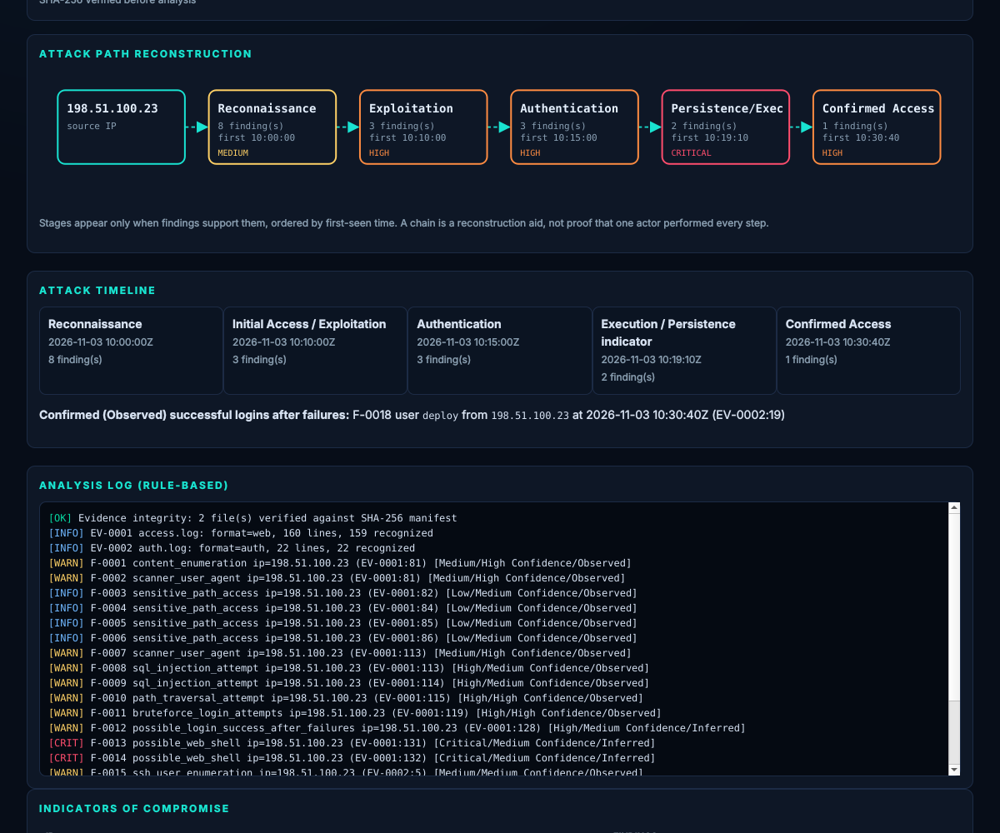
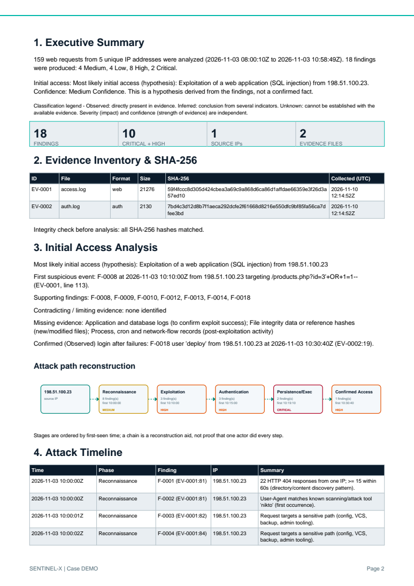

<p align="center"></p>
<h1 align="center">SENTINEL-X</h1>
<p align="center"><b>AI-assisted digital forensics &amp; incident investigation</b> for Kali / Debian Linux<br>
Defensive - read-only - evidence-based. Author: <b>THEEVVEN</b></p>
<p align="center"><a href="https://github.com/cybertheevven/SENTINEL-X/actions/workflows/ci.yml"></a>
 </p>

SENTINEL-X turns server logs into an **investigation**: it verifies evidence (SHA-256), detects suspicious activity,
reconstructs an **attack path and timeline**, correlates web and SSH activity, and produces a **PDF report and an offline HTML dashboard**
- always showing what is *Observed*, what is *Inferred* and what is *Unknown*.



## Try it in 30 seconds
```bash
git clone https://github.com/cybertheevven/SENTINEL-X.git && cd SENTINEL-X
./scripts/install.sh          # private venv, works with Kali's externally-managed Python
sentinel-x demo               # synthetic logs -> analysis -> PDF + HTML + JSON in ./sentinel-x-demo/reports
xdg-open sentinel-x-demo/reports/DEMO_report.html
```

## What it does (v0.2.0)
| Area | Implemented |
|---|---|
| Evidence | read-only working copy, SHA-256, EV-IDs, manifest, custody log, tamper check before every analysis |
| Logs | Apache/Nginx access logs, SSH `auth.log` / `secure` (classic + ISO syslog), automatic format detection |
| Detection | SQLi, path traversal, web shell, sensitive paths, scanner User-Agents, web brute force, 404 enumeration, SSH brute force, SSH user enumeration, successful SSH login after failures, root login |
| Investigation | initial-access hypothesis (or `Undetermined`), web<->SSH correlation, timeline, attack-path graph, IOC list, remediation recommendations |
| Reports | PDF (cover, KPIs, graph, timeline, findings, SHA-256 inventory, remediation), self-contained HTML dashboard, JSON |
| AI (optional) | local Ollama summary; receives findings only; every cited ID is validated, unverifiable output is flagged |

Not yet (roadmap): file-integrity / persistence analysis, DB logs, IOC enrichment (ASN/geo), SQLite case DB, FastAPI dashboard, cloud AI. See [docs/STATUS.md](docs/STATUS.md).



## Usage
```bash
sentinel-x case create --name Incident-001
sentinel-x evidence add --case Incident-001 --path ./logs/        # access.log, auth.log, ...
sentinel-x evidence verify --case Incident-001
sentinel-x analyze --case Incident-001 [--year 2026]                # --year for syslog files without a year
sentinel-x ai investigate --case Incident-001                       # optional (Ollama)
sentinel-x report generate --case Incident-001 --format all         # pdf + json + html
```
Cases live in `~/.sentinel-x/cases` (`--home` or `SENTINEL_X_HOME` to change). More: [docs/USER_GUIDE.md](docs/USER_GUIDE.md).

## Principles
- Originals are never modified; analysis uses a read-only copy whose hash is re-checked.
- Every finding cites evidence ID + line. **Severity** (impact) is separate from **confidence** (strength of evidence).
- A malicious-looking request is *Observed*; whether it *succeeded* is *Unknown* unless other evidence shows it.
- "Initial Access: Undetermined" when evidence is insufficient. Nothing is invented. HTML/PDF output escapes attacker-controlled log content.

## Optional: local AI
```bash
curl -fsSL https://ollama.com/install.sh | sh && ollama pull llama3.1
sentinel-x ai investigate --case Incident-001
```

## Development
```bash
python3 -m unittest discover -s tests -t . -p "test_*.py"
docker compose build        # Dockerfile provided
```
## Legal
Use only on systems and evidence you are authorized to analyze. MIT License. See [SECURITY.md](SECURITY.md).
## Disclaimer
SENTINEL-X is intended for authorized and educational use only.
The author is not responsible for misuse.
